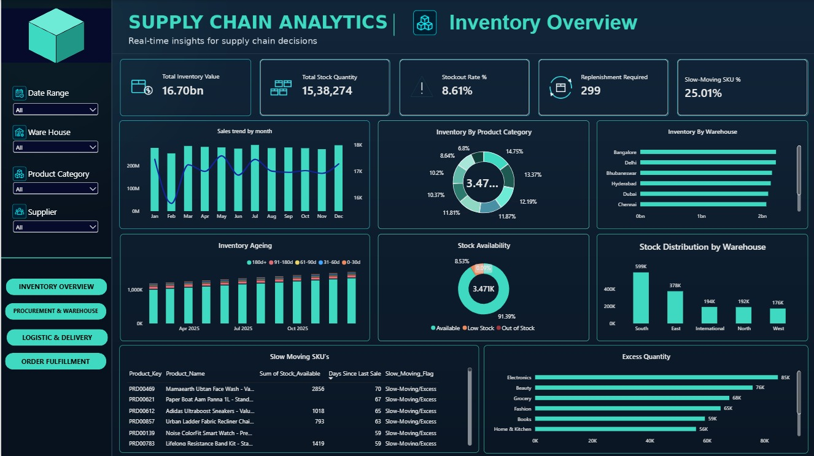
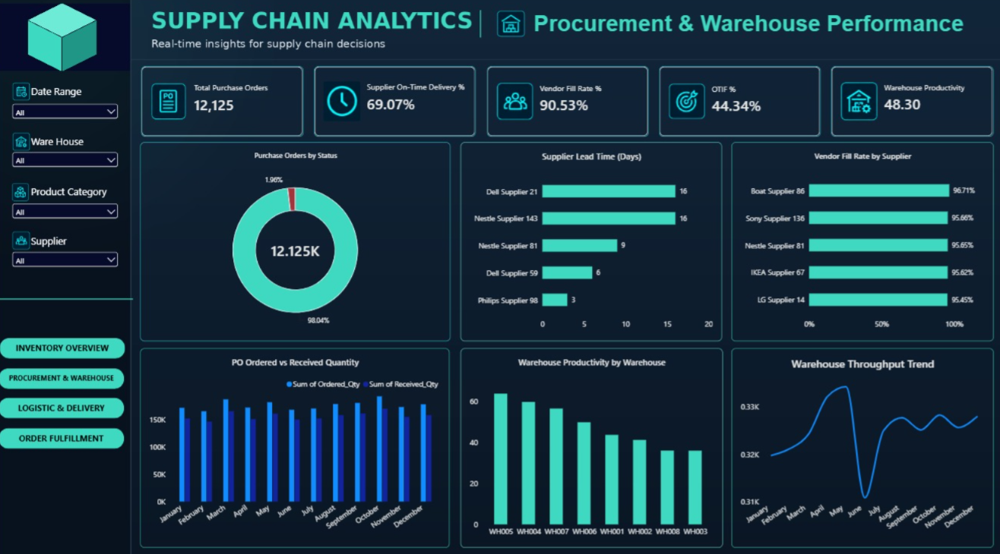
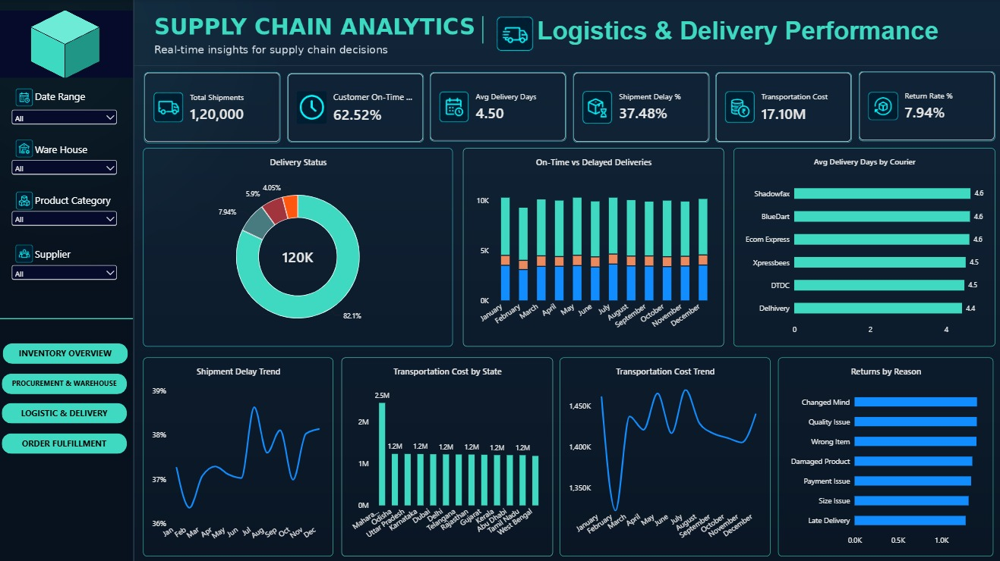
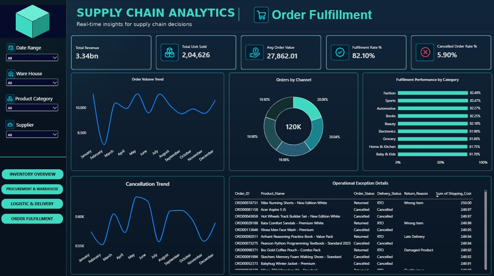

# Supply Chain Analytics Dashboard (SQL Server + Power BI)

An end-to-end supply chain analytics project covering inventory health, procurement, warehousing, logistics and order fulfilment, built on a large retail transactional dataset (2022–2025).

**Stack:** SQL Server (T-SQL) · Power BI (DAX, Power Query) · Python (Jupyter, pandas, pyodbc, SQLAlchemy)

---

## 1. Business Problem

Operations, procurement and logistics teams needed one governed view to answer:

- Which products are at risk of stocking out, and which are overstocked and tying up capital?
- Which suppliers are slow, and how is that hurting on-time-in-full delivery?
- Where in the delivery network are orders running late, and what does that cost?
- How do returns and cancellations connect back to delivery and fulfilment performance?

## 2. Dashboard Pages

| Page | Focus |
|---|---|
| Inventory Overview | Stock value, stock-outs, slow-moving/excess stock, ageing, stock by warehouse |
| Procurement & Warehouse Performance | Purchase orders, supplier lead time, vendor fill rate, OTIF, warehouse productivity |
| Logistics & Delivery Performance | On-time vs delayed shipments, courier comparison, transportation cost by state, returns by reason |
| Order Fulfilment | Revenue, units, fulfilment and cancellation rates, operational exceptions |

### Inventory Overview


### Procurement & Warehouse Performance


### Logistics & Delivery Performance


### Order Fulfilment


## 3. Key Findings

| Area | Result |
|---|---|
| Inventory value | ₹16.70 Bn across 15,38,274 units |
| Stock-out rate | 8.61% (299 SKUs at or below reorder level) |
| Slow-moving SKUs | 25.01%, led by Electronics (85K excess units) and Beauty (76K) |
| Purchase orders | 12,125 |
| OTIF | 44.34% |
| Vendor fill rate | 90.53% |
| Supplier on-time delivery | 69.07% |
| Supplier lead time | 3 days (best) to 16 days (slowest suppliers) |
| Shipments | 1,20,000; 62.52% on time, 37.48% delayed; 4.50 avg delivery days |
| Transportation cost | ₹17.10M; Maharashtra ₹2.5M, about 2x any other state |
| Revenue / units | ₹3.34 Bn / 2,04,626 units |
| Fulfilment / cancellation / return rate | 82.10% / 5.90% / 7.94% |

**Insights**

- OTIF is a **timing** problem, not a quantity problem: fill rate is 90.53% but only 69.07% of supplier deliveries arrive on time.
- Courier performance is tightly banded (4.4–4.6 days), so delays are route/state-driven rather than caused by one weak courier.
- Cancellations plus returns remove roughly 13.8% of placed orders, spread evenly across categories, which points to a systemic packaging/QC and delivery-timing fix.

## 4. Recommendations

1. Action the 299 at-risk SKUs and run markdown/bundling on the slow-moving share, starting with Electronics and Beauty.
2. Renegotiate lead times with the 16-day suppliers, using the 3-day supplier as the benchmark.
3. Prioritise Maharashtra for carrier renegotiation or route consolidation.
4. Investigate the roughly 2x productivity gap between the best and worst warehouse.
5. Run a joint QC/packaging and delivery-timing review on cancellations and returns.
6. Adopt the dashboard as a monthly operating review against these baselines.

## 5. Data Model

Star schema in SQL Server (database `SUPPLY_CHAIN_Project`, with `staging` and `dbo` schemas): dimensions `dim_date`, `Product_master`, `Supplier_master`, `Warehouse_master`; core facts `Sales_master`, `Delivery_master`, `Inventory_master`; supplementary tables `Purchase_Orders`, `Warehouse_Productivity`, `Inventory_Ageing`; plus a FIFO-reconstructed inventory ageing trend table.

### Data Scope Note

The core transactional data covers sales, orders, inventory, delivery and returns. It has no purchase-order or warehouse-operations records, so the procurement and warehouse layer (purchase orders, OTIF, vendor fill rate, warehouse productivity, inventory ageing) is built on three synthetic supplementary tables: `Purchase_Orders` (ordered vs received quantity, OTIF, vendor fill rate), `Warehouse_Productivity` and `Inventory_Ageing`. It uses a fixed random seed, is keyed to real product, supplier and warehouse IDs, and is flagged with a `Data_Source` column. The model is built so ERP/PO data can replace it without changing the dashboard logic.

## 6. Bugs Found and Fixed

- **DAX blank coercion:** `BLANK() <= number` evaluates TRUE, silently inflating on-time delivery %.
- **Circular dependency:** caused by a calculated sort column; resolved by moving sort logic to Power Query.
- **Silent relationship break:** returned zeros for Days Since Last Sale; fixed and validated.
- **Stray page-level filter** left from debugging was contaminating visuals.
- **Undercounted stacked chart (about 40x):** counted a nullable column instead of `Order_ID`.
- **Synthetic calibration:** first runs gave implausible KPIs (near-zero OTIF, near-universal slow-mover flags) and were recalibrated and validated.

## 7. Repository Structure

```
supply-chain-analytics/
├── README.md
├── sql/            # schema, data-quality checks, KPI queries
├── data/           # sample/raw CSVs and supplementary tables
├── notebooks/      # Jupyter notebook (SQL Server connection + CSV fallback)
├── powerbi/        # .pbix file
├── images/         # dashboard screenshots
└── docs/           # business summary document
```

## 8. How to Run

1. Create the database in SQL Server and run the scripts in `/sql` in order (schema, load, data-quality checks, KPI queries).
2. Open `powerbi/Supply_Chain_Analytics.pbix` and update the data source to your SQL Server instance.
3. (Optional) Run the notebook in `/notebooks`; it falls back to the CSVs in `/data` if SQL Server is unavailable.

## 9. Author

**Priyambada Rout** — Data Analyst, Bangalore
[LinkedIn](https://www.linkedin.com/in/your-profile) · [Email](mailto:your-email@example.com)
